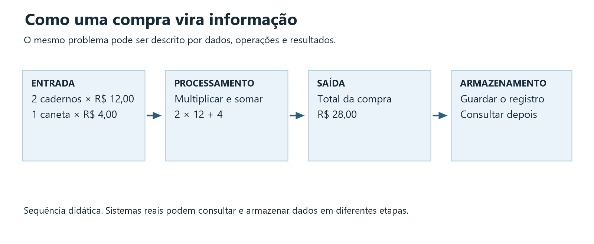
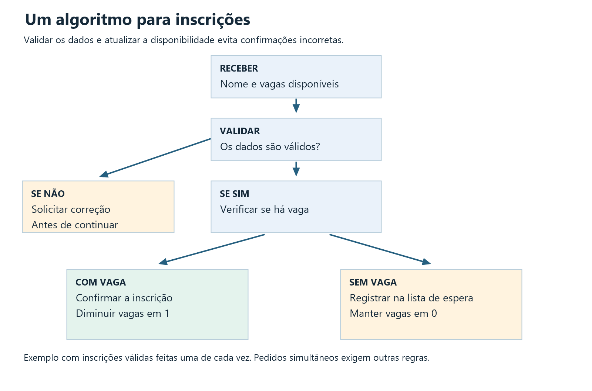
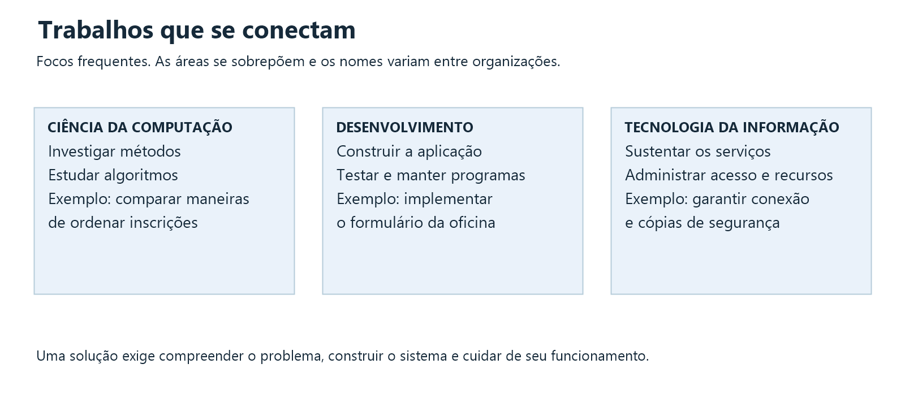
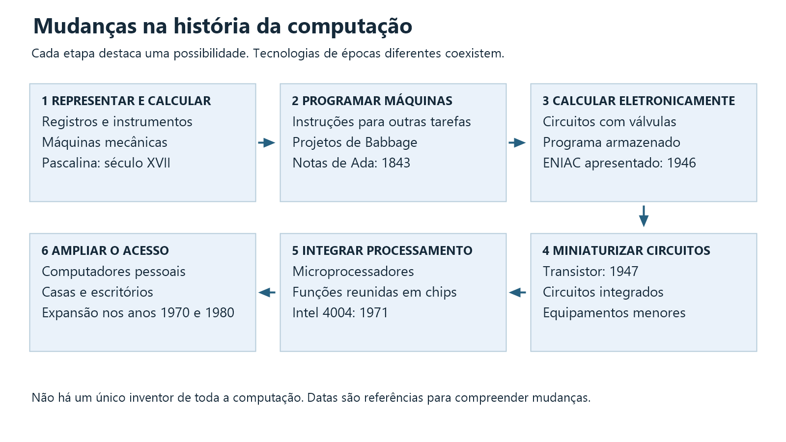
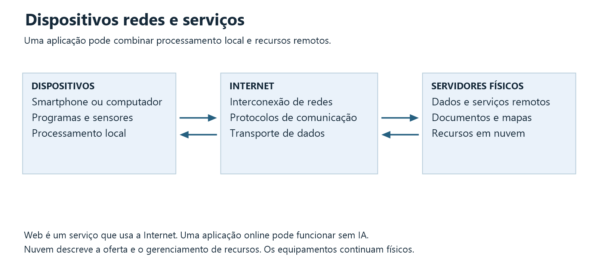

<!-- pagina: 00-boas-vindas -->
# Módulo 1 — Introdução ao Mundo da Computação

**Descobrindo o Mundo Tech · FullDev School**

## Boas-vindas

Quando você usa um mapa no celular, paga uma compra ou consulta uma informação, sistemas de computação ajudam a realizar essas tarefas. Neste módulo, você vai conhecer os conceitos básicos por trás delas e acompanhar como a computação chegou às tecnologias do cotidiano.

Você não precisa saber programar. O percurso começa com exemplos familiares e apresenta, passo a passo, como informações são representadas e como procedimentos resolvem problemas.

## Índice do módulo

1. [Aula 1 — Computação e informação no cotidiano]($WIKI_REFERENCE$/pages/01-computacao-e-informacao)
2. [Aula 2 — Problemas, algoritmos e áreas de atuação]($WIKI_REFERENCE$/pages/02-problemas-algoritmos-e-areas)
3. [Aula 3 — Do cálculo às máquinas programáveis]($WIKI_REFERENCE$/pages/03-evolucao-das-maquinas)
4. [Aula 4 — Internet, smartphones, nuvem e Inteligência Artificial]($WIKI_REFERENCE$/pages/04-computacao-conectada)
5. [Atividade integradora — Um sistema do cotidiano]($WIKI_REFERENCE$/pages/05-atividade-integradora)
6. [Verificação da aprendizagem]($WIKI_REFERENCE$/pages/06-verificacao-da-aprendizagem)
7. [Aprofundamentos opcionais]($WIKI_REFERENCE$/pages/07-aprofundamentos-opcionais)
8. [Glossário e referências]($WIKI_REFERENCE$/pages/08-glossario-e-referencias)

## Seu percurso

As quatro aulas levam cerca de **40 minutos cada**. Reserve mais **20 minutos** para a atividade integradora e **15 minutos** para a verificação. O percurso principal dura aproximadamente **3 horas e 15 minutos**. Os vídeos em português e os aprofundamentos são complementares; todo o conteúdo necessário está nos textos.

Leia cada aula na ordem, observe os diagramas e responda às perguntas de pausa. Na atividade integradora, aplique os conceitos a um sistema do cotidiano. Ao final, retome suas respostas iniciais e observe o que aprendeu.

## Antes de começar

Responda sem pesquisar. Guarde suas respostas para compará-las com o que você saberá ao concluir o módulo.

1. Em quais situações do seu dia existe computação?
2. Um algoritmo precisa estar escrito em uma linguagem de programação?
3. Qual é a diferença entre estar conectado à Internet e abrir uma página da Web?
4. Quando alguém diz que um arquivo está na nuvem, onde você imagina que ele esteja?

<!-- pagina: 01-computacao-e-informacao -->
# Aula 1 Computação e informação no cotidiano

## Uma compra como ponto de partida

Imagine uma papelaria. Você compra dois cadernos de R$ 12,00 e uma caneta de R$ 4,00. O caixa registra os produtos, calcula o total de R$ 28,00 e gera um comprovante.

O sistema recebe dados, executa operações e apresenta um resultado. Essa mesma estrutura aparece em tarefas muito diferentes. Um aplicativo de mapas recebe uma origem e um destino. Um sistema de inscrição recebe informações de participantes e verifica as vagas disponíveis.

Neste módulo, chamamos de **computação** o estudo e a realização de processos que representam e transformam informações seguindo procedimentos. Computadores digitais executam esses procedimentos com circuitos e programas.

Um computador pode ser um notebook, um servidor ou um componente dentro de outro equipamento. Um smartphone também é um computador. A presença de uma tela grande ou de um teclado separado não define se um dispositivo realiza computação.

## Dados e informação

**Dado** é um registro que pode ser armazenado ou processado. Um número, uma palavra, uma imagem e uma medida de temperatura são exemplos de dados.

**Informação** é o significado que atribuímos aos dados em um contexto. O registro “28” sozinho não diz muito. “Total da compra: R$ 28,00” permite compreender o que esse valor representa.

Essa distinção ajuda a perceber que guardar dados não basta. Precisamos saber a que eles se referem, como foram obtidos e se são adequados à tarefa. O mesmo registro pode ser resultado de uma operação e entrada de outra.

| Registro | Contexto | Informação obtida |
| --- | --- | --- |
| 28 | Valor em reais calculado pelo caixa | A compra custa R$ 28,00 |
| 18 | Quantidade de pessoas inscritas em uma oficina | Há 18 inscrições registradas |
| 07:30 | Horário de início de uma atividade | A atividade começa às 7h30 |

Computadores digitais representam esses registros por combinações de bits. Um **bit** pode assumir um de dois valores, normalmente escritos como 0 e 1. Diferentes regras de representação permitem registrar números, textos, imagens e sons. Você vai aprofundar esse assunto em outros módulos.

## Entrada, processamento, saída e armazenamento

Uma forma de entender um sistema é observar quatro elementos:

1. **Entrada.** Os dados recebidos, como produtos, quantidades e preços.
2. **Processamento.** As operações realizadas, como multiplicar preços por quantidades e somar os valores.
3. **Saída.** O resultado apresentado, como o total e o comprovante.
4. **Armazenamento.** Os registros guardados, como o histórico da venda.



**Descrição da imagem.** Produtos, quantidades e preços entram no sistema. O processamento calcula 2 × 12 + 4. A saída informa R$ 28,00. Depois, o registro da venda é armazenado.

Esse desenho mostra uma sequência didática. Sistemas reais podem receber novas entradas, consultar registros já guardados e produzir várias saídas ao mesmo tempo. O armazenamento pode acontecer em diferentes momentos.

## Hardware e software em poucas palavras

**Hardware** é a parte física do sistema. Inclui processador, memória, teclado, sensores e tela. **Software** é o conjunto de programas e instruções que orientam o funcionamento do equipamento.

No caixa da papelaria, o leitor de códigos é hardware. O programa que registra a venda é software. O leitor envia dados, e o programa usa esses dados para consultar produtos e calcular valores.

Um erro pode surgir em diferentes pontos. O leitor pode estar desconectado. O preço registrado pode estar incorreto. O cálculo pode ter sido implementado de forma errada. Observar a origem do problema evita tratar todos os erros como se fossem iguais.

### Vídeo sobre hardware e software

[Assistir a Hardware e Software, Desvendando as Diferenças Fundamentais](https://www.youtube.com/watch?v=Y7zvYG4NAxg)

**Responsável:** Canal TI. **Duração:** 2min20s. **Idioma:** português. **Uso:** complemento opcional.

Observe a distinção entre componentes físicos e programas e relacione os exemplos ao caixa da papelaria. O objetivo aqui é reconhecer funções, sem aprofundar a arquitetura do equipamento.

**Depois de assistir:** no exemplo da papelaria, qual parte precisa ser corrigida se o leitor estiver desconectado? E se o preço estiver cadastrado errado?

## Computação além da programação

Antes de escrever um programa para a papelaria, alguém precisa entender como as vendas acontecem. Quais produtos existem? Como os preços são atualizados? Quem pode corrigir um registro? Como lidar com uma quantidade inválida?

Depois da programação, também há trabalho. É preciso testar o sistema, acompanhar falhas, cuidar do acesso aos dados e ajudar quem o utiliza. A computação reúne investigação, construção e operação de soluções.

Algumas tarefas podem ser feitas em uma planilha ou com uma ferramenta já existente. Criar um programa novo é uma das alternativas. A escolha depende da necessidade, dos recursos disponíveis e das consequências de um erro.

## Pause e pense

Considere um aplicativo que informa se você chegou à meta diária de passos.

1. Qual dado ele recebe do dispositivo?
2. Que comparação ele realiza?
3. Que resultado ele apresenta?
4. Por que guardar os registros de dias anteriores pode ser útil?

Agora pense em uma situação em que um dado incorreto produziria uma informação enganosa. Explique o erro sem usar informações pessoais reais.

## Prática da aula

Escolha um destes sistemas: caixa de supermercado, agenda digital ou controle de empréstimo de livros. Escreva uma entrada, um processamento, uma saída e um registro armazenado. Acrescente um exemplo de hardware e um de software.

**Você concluiu esta aula quando consegue** explicar uma tarefa usando esses elementos e perceber que o resultado depende da qualidade dos dados e das operações.

<!-- pagina: 02-problemas-algoritmos-e-areas -->
# Aula 2 Problemas algoritmos e áreas de atuação

## O que é um problema computacional

Um problema computacional é uma tarefa descrita de modo que possamos estudar sua solução por procedimentos. Para começar, precisamos saber quais dados entram e qual resultado esperamos.

“Organizar melhor uma oficina” ainda é uma necessidade ampla. “Dada uma lista de inscrições e o número de vagas, identificar quem pode ocupar cada vaga” descreve uma tarefa mais precisa.

É útil estabelecer também os limites. Uma pessoa pode se inscrever duas vezes? A ordem de chegada decide a vaga? O que acontece quando todas as vagas acabam? Essas condições orientam a solução.

Nem todo problema é bem definido desde o início. Entender a situação e conversar com as pessoas envolvidas faz parte do trabalho. Uma solução tecnicamente correta pode atender à regra errada.

## Algoritmo

Um **algoritmo** é uma sequência organizada de instruções para realizar uma tarefa. As instruções precisam ser suficientemente claras para quem vai executá-las.

Você pode representar um algoritmo em linguagem natural, em um desenho ou em pseudocódigo. **Pseudocódigo** é uma descrição estruturada dos passos que não depende das regras de uma linguagem de programação específica.

Um **programa** é uma implementação de instruções em uma forma executável por um sistema computacional. O algoritmo descreve a solução. O programa coloca essa solução em funcionamento em um ambiente concreto.

Uma pessoa pode seguir um algoritmo com papel e lápis. Ao executar a tarefa em um computador, também precisamos escolher como representar os dados e como receber e apresentar resultados.

### Vídeo sobre algoritmos

[Assistir a Introdução a Algoritmos, Curso de Algoritmos número 1](https://www.youtube.com/watch?v=8mei6uVttho)

**Responsável:** Curso em Vídeo, Gustavo Guanabara. **Duração:** 14min08s. **Idioma:** português. **Uso:** complemento opcional.

A aula introduz algoritmos com situações do cotidiano. Relacione a explicação à diferença entre descrever uma solução e implementá-la em um programa. Não é necessário seguir o restante do curso ou instalar uma ferramenta.

**Depois de assistir:** escreva quatro passos para uma tarefa cotidiana e identifique uma instrução que ficaria ambígua para outra pessoa.

## Exemplo de cálculo

Retome a compra de dois cadernos de R$ 12,00 e uma caneta de R$ 4,00. Uma sequência possível é:

1. Receber a quantidade e o preço de cada produto.
2. Verificar se as quantidades são inteiras e positivas e se os preços não são negativos.
3. Multiplicar a quantidade pelo preço de cada produto.
4. Somar os valores calculados.
5. Apresentar o total de R$ 28,00.

O segundo passo trata entradas inadequadas antes do cálculo. Se a quantidade for “dois” em um campo que aceita apenas números, o programa precisa interpretar o texto ou pedir uma correção.

## Decisão e repetição

Algoritmos podem incluir **decisões**. O próximo passo depende de uma condição. Se há vaga, uma inscrição pode ser confirmada. Se não há vaga, ela pode entrar em uma lista de espera.

Também podem incluir **repetições**. Uma mesma operação é executada para cada item de uma lista. No caixa, o programa calcula o valor de cada produto antes de obter o total.

Veja um pseudocódigo para uma inscrição individual:

```text
Receber o nome e a quantidade de vagas disponíveis
Se o nome estiver vazio ou a quantidade de vagas for inválida
    Solicitar a correção dos dados
Senão, se houver pelo menos uma vaga
    Confirmar a inscrição
    Diminuir a quantidade de vagas disponíveis em uma unidade
Senão
    Registrar a pessoa na lista de espera
Apresentar o resultado
```



**Descrição da imagem.** Após receber e validar os dados, o sistema verifica a disponibilidade. Com vaga, confirma e reduz a quantidade disponível. Sem vaga, registra na lista de espera. Dados inválidos exigem correção antes da decisão.

O exemplo deixa de fora problemas como duas inscrições simultâneas ou pedidos duplicados. Em um sistema real, a equipe precisa tratar essas situações. Uma representação introdutória ajuda a compreender a lógica sem esconder seus limites.

## Automatização

**Automatizar** é fazer um sistema executar tarefas com menor necessidade de intervenção manual a cada etapa. O envio de uma confirmação após uma inscrição é um exemplo.

Automatização não garante correção. Se a regra permite inscrições repetidas, o sistema pode repetir o erro rapidamente. Por isso, precisamos definir regras, testar casos e acompanhar resultados.

Uma automatização pode usar regras fixas, sem Inteligência Artificial. Comparar o número de inscritos com o número de vagas não exige um modelo de IA.

## Como testar uma ideia

Antes de programar, simule os passos com alguns casos. Essa prática permite encontrar instruções ausentes ou ambíguas.

| Caso | Entrada | Resultado esperado |
| --- | --- | --- |
| Há vaga | Nome preenchido e 2 vagas disponíveis | Inscrição confirmada e 1 vaga restante |
| Não há vaga | Nome preenchido e 0 vagas disponíveis | Registro na lista de espera |
| Nome ausente | Nome vazio e 2 vagas disponíveis | Solicitação de correção |
| Quantidade inválida | Nome preenchido e -1 vaga disponível | Solicitação de correção |

Não basta testar o caso em que tudo funciona. Entradas vazias, limites e valores inesperados também fazem parte da tarefa.

## Ciência da Computação Desenvolvimento de Software e TI

Essas áreas se relacionam, e suas fronteiras variam conforme a organização. A comparação abaixo mostra focos frequentes de trabalho.

| Área | Foco introdutório | Exemplo na oficina |
| --- | --- | --- |
| Ciência da Computação | Estudar fundamentos, modelos de computação, algoritmos e suas propriedades | Comparar métodos para ordenar muitas inscrições |
| Desenvolvimento de Software | Projetar, construir, testar e manter aplicações | Criar o formulário e implementar as regras de inscrição |
| Tecnologia da Informação | Planejar, integrar, operar e proteger recursos e serviços tecnológicos | Administrar acessos, conectividade, cópias de segurança e disponibilidade |



**Descrição da imagem.** A Ciência da Computação investiga métodos. O Desenvolvimento de Software constrói a aplicação. A TI sustenta os serviços. Os trabalhos se conectam para atender às pessoas.

Uma pessoa que desenvolve software também usa algoritmos e cuida de segurança. Profissionais de TI podem programar automatizações. O objetivo dessa distinção é ampliar sua visão, sem transformar os exemplos em divisões rígidas ou em uma lista de diplomas.

## Prática da aula

Escreva um algoritmo para organizar uma fila de atendimento por ordem de chegada. Considere uma pessoa por vez e use nomes fictícios.

1. Defina os dados de entrada e o resultado esperado.
2. Escreva entre cinco e oito passos.
3. Inclua o caso em que a fila está vazia.
4. Simule uma fila com três pessoas.
5. Identifique uma tarefa de desenvolvimento e uma tarefa de TI que ajudariam a colocar essa solução em uso.

**Você concluiu esta aula quando consegue** transformar uma necessidade em uma tarefa definida, escrever passos claros e reconhecer que construir e operar uma solução envolve diferentes trabalhos.

<!-- pagina: 03-evolucao-das-maquinas -->
# Aula 3 Do cálculo às máquinas programáveis

## Por que olhar para a história

Os computadores atuais resultam de muitas contribuições. Pessoas buscaram formas de registrar quantidades, reduzir erros de cálculo e repetir procedimentos. Outras desenvolveram circuitos, programas e formas de compartilhar informações.

A história da computação não tem um único inventor ou uma sequência em que toda novidade elimina a anterior. Tecnologias diferentes coexistem. Até hoje usamos papel, calculadoras, servidores e celulares em tarefas distintas.

Nesta aula, observe a relação entre uma necessidade e uma mudança técnica. As datas funcionam como referência. O objetivo é compreender o percurso, sem decorar uma lista de anos.

## Primeiras formas de cálculo

Muito antes dos computadores eletrônicos, pessoas usavam marcas, objetos e instrumentos para contar. O ábaco organiza quantidades por posições e permite realizar operações com movimentos de peças.

Esses instrumentos mostram uma ideia que continua presente na computação. Podemos representar um problema de maneira organizada e seguir um procedimento para chegar a um resultado.

Um ábaco depende da ação e das regras aplicadas pela pessoa. Ele não funciona como um computador digital programável. Ainda assim, ajuda a entender que calcular e representar informações são atividades anteriores à eletrônica.

### Vídeo sobre as primeiras formas de cálculo

[Assistir a Os computadores eram pessoas!, Saga dos Computadores episódio 1](https://www.youtube.com/watch?v=xajcV4lwY3Q)

**Responsável:** Manual do Mundo. **Duração:** 20min48s. **Idioma:** português. **Uso:** aprofundamento opcional.

O episódio apresenta instrumentos e mecanismos de cálculo e o trabalho de pessoas chamadas de computadores. Observe o que era realizado manualmente e o que passou a ser feito por uma máquina.

**Depois de assistir:** explique por que usar uma máquina de cálculo e programar um computador não são necessariamente a mesma tarefa.

## Máquinas mecânicas

No século XVII, surgiram máquinas que realizavam operações com mecanismos físicos. A Pascalina, desenvolvida por Blaise Pascal a partir de 1642, usava engrenagens para apoiar cálculos de adição e subtração.

Essas máquinas incorporavam parte do procedimento em sua construção. Em geral, tinham funções limitadas. Mudar a tarefa podia exigir outro equipamento ou alterações no mecanismo.

O avanço central aqui é a mecanização de operações. A máquina executa parte do trabalho que antes dependia de cálculos manuais.

## A ideia de uma máquina programável

No século XIX, mecanismos controlados por cartões perfurados ajudaram a mostrar que uma sequência de instruções poderia orientar uma máquina. Cartões eram usados em teares para definir padrões de tecido.

Charles Babbage projetou a Máquina Analítica, que previa memória e uma unidade de operações. O projeto buscava executar diferentes cálculos a partir de instruções. A máquina completa não foi construída durante sua vida.

Ada Lovelace publicou notas sobre esse projeto em 1843. Ela descreveu procedimentos e discutiu possibilidades de trabalhar com representações além de quantidades. Seus escritos são um marco na história da programação. Esses fatos podem ser consultados no [Science Museum](https://blog.sciencemuseum.org.uk/ada-lovelace-visionary-of-the-computer-age/).

**Programável** significa que o comportamento pode ser orientado por instruções para realizar tarefas diferentes. É uma mudança importante em relação a equipamentos construídos para uma única operação fixa.

## Computadores eletromecânicos e eletrônicos

No século XX, surgiram máquinas que combinavam mecanismos e eletricidade. Relés funcionavam como interruptores controlados eletricamente. Depois, circuitos com válvulas permitiram executar operações sem depender do movimento de peças a cada passo.

O ENIAC, apresentado publicamente em 1946, foi um marco entre os computadores eletrônicos de propósito geral. Ele ocupava uma grande área e usava milhares de válvulas. Sua configuração inicial envolvia conexões e ajustes físicos para orientar os cálculos. Veja o registro do [Computer History Museum sobre 1946](https://www.computerhistory.org/timeline/1946/).

**Propósito geral** indica que a máquina pode realizar diferentes tipos de tarefa, conforme sua configuração ou programação. Isso não significa que os primeiros equipamentos tivessem a facilidade de uso dos computadores atuais.

Evite a conclusão de que o ENIAC foi “o primeiro computador” em qualquer sentido. A resposta depende do critério usado, como ser eletrônico, digital, programável ou de propósito geral.

### Vídeo sobre a passagem à eletricidade

[Assistir a A revolução elétrica, Saga dos Computadores episódio 2](https://www.youtube.com/watch?v=uQPiyxoCk9E)

**Responsável:** Manual do Mundo. **Duração:** 15min58s. **Idioma:** português. **Uso:** aprofundamento opcional.

O episódio ajuda a visualizar a passagem de mecanismos de cálculo a equipamentos elétricos e o papel de componentes que controlam sinais. Compare essas mudanças com os computadores eletromecânicos e eletrônicos apresentados no texto.

**Depois de assistir:** identifique uma limitação das máquinas anteriores que o uso da eletricidade ajudou a enfrentar. Não é necessário reproduzir os experimentos.

## Programa armazenado

A ideia de guardar instruções na memória, junto com dados, tornou o uso dos computadores mais flexível. Em vez de depender de uma nova organização física de conexões para cada tarefa, a máquina podia ler instruções armazenadas.

John von Neumann participou da divulgação dessa organização em um relatório de 1945 sobre o EDVAC. A construção dessas ideias envolveu várias pessoas e equipes. O nome “arquitetura de von Neumann” ficou associado a um modelo que reúne memória, processamento e entrada e saída.

Para este módulo, guarde a relação. O hardware executa operações, e um programa armazenado orienta a sequência. O funcionamento detalhado da memória e do processador será estudado depois.

## Transistores circuitos integrados e microprocessadores

O transistor foi demonstrado nos Bell Labs em 1947. Ele pode controlar sinais elétricos e funcionar como chave eletrônica. Seu uso em computadores contribuiu para reduzir tamanho e consumo em comparação com soluções baseadas em válvulas. Consulte a [história dos Bell Labs](https://www.nokia.com/bell-labs/about/history/).

Um **circuito integrado** reúne componentes eletrônicos em um mesmo chip. Um **microprocessador** reúne as funções centrais de processamento em um circuito integrado. Os termos não são sinônimos. Há chips de memória e outros circuitos que não são microprocessadores.

Em 1971, o Intel 4004 foi lançado como um marco comercial dos microprocessadores. A integração de funções em chips ajudou a viabilizar equipamentos menores. O [Computer History Museum registra esse avanço em 1971](https://www.computerhistory.org/timeline/1971/).

Você não precisa conhecer a física desses componentes agora. A relação principal é que a integração e a miniaturização ampliaram as possibilidades de construir computadores e incorporá-los a outros produtos.

## Computadores pessoais

Na década de 1970, computadores menores passaram a chegar a mais pessoas e organizações. Equipamentos como Apple II, Commodore PET e TRS-80, lançados em 1977, fazem parte desse percurso. O IBM PC, lançado em 1981, também influenciou o mercado. Consulte os registros do [Computer History Museum de 1977](https://www.computerhistory.org/timeline/1977/) e de [1981](https://www.computerhistory.org/timeline/1981/).

O computador pessoal aproximou a computação de tarefas como escrever, organizar contas e aprender programação. Interfaces gráficas e novos programas facilitaram o uso ao longo do tempo.

Essa ampliação não ocorreu igualmente para todas as pessoas. Preço, infraestrutura e oportunidades de aprendizagem continuaram influenciando o acesso à tecnologia.



**Descrição da imagem.** A linha do tempo apresenta seis etapas. Cada etapa destaca uma mudança: representar quantidades, mecanizar operações, orientar máquinas por instruções, calcular eletronicamente, integrar circuitos e ampliar o acesso a computadores pessoais. As etapas não indicam que tecnologias anteriores desapareceram.

## Prática da aula

Escolha três mudanças apresentadas e complete para cada uma:

- Qual dificuldade ajudou a enfrentar?
- O que passou a ser feito de outra maneira?
- Como essa mudança se relaciona com um equipamento atual?

Exemplo de resposta inicial: a miniaturização de circuitos ajudou a colocar capacidade de processamento em dispositivos portáteis. Desenvolva outros exemplos com suas palavras.

**Você concluiu esta aula quando consegue** explicar como instruções programáveis e circuitos menores mudaram o uso dos computadores, sem atribuir todo o percurso a uma única pessoa.

<!-- pagina: 04-computacao-conectada -->
# Aula 4 Internet smartphones nuvem e Inteligência Artificial

## Da máquina isolada às redes

Uma rede conecta equipamentos para trocar dados e compartilhar recursos. Duas máquinas ligadas em uma organização já podem formar parte de uma rede. A conexão não precisa ser com a Internet.

A **Internet** reúne redes que se comunicam usando protocolos compatíveis. Um **protocolo** é um conjunto de regras para a comunicação. Pense em pessoas que combinam um idioma e uma forma de enviar e confirmar mensagens.

A ARPANET, que conectou seus primeiros equipamentos em 1969, foi um marco desse desenvolvimento. A adoção de TCP/IP na ARPANET em 1983 também faz parte da formação da Internet. O percurso envolveu várias redes e equipes. Consulte a [história da Internet publicada pela Internet Society](https://www.internetsociety.org/internet/history-internet/brief-history-internet/).

Nesta etapa, não é necessário decorar os nomes dos protocolos. Entenda que conectar equipamentos exige regras comuns e infraestrutura física, como cabos, antenas e dispositivos de rede.

## Internet e Web

A **Web** é um sistema de páginas e recursos ligados por endereços e hiperlinks, normalmente acessados em um navegador. Ela utiliza a Internet como infraestrutura de comunicação.

Tim Berners-Lee propôs a Web em 1989 enquanto trabalhava no CERN. O [CERN apresenta a origem desse projeto](https://home.cern/science/computing/the-birth-of-the-web/).

A Internet já existia antes da Web. Correio eletrônico e outros serviços também utilizam a Internet. Aplicativos podem trocar dados pela rede sem mostrar páginas de um navegador.

**Exemplo.** Abrir uma página de notícias envolve a Web. A infraestrutura que transporta os dados faz parte da Internet. Um programa de correio eletrônico pode usar outros protocolos para enviar mensagens.

### Vídeo sobre a Internet

[Assistir a Como a Internet funciona?](https://www.youtube.com/watch?v=nlO5hySqJFA)

**Responsável:** Curso em Vídeo, Gustavo Guanabara. **Duração:** 22min15s. **Idioma:** português. **Uso:** complemento opcional.

Observe como os dados percorrem redes e chegam a servidores. Use o texto desta aula para distinguir essa infraestrutura dos serviços que funcionam sobre ela. Os detalhes de IP e DNS serão aprofundados em outros módulos. Não é necessário memorizar configurações ou seguir o curso de HTML e CSS.

**Depois de assistir:** por que a Internet pode continuar sendo usada quando nenhum navegador está aberto?

## Smartphones

O smartphone reúne processamento, memória, sistema operacional, aplicativos e recursos de comunicação em um dispositivo portátil. Sensores, câmera e localização ampliam suas formas de receber dados.

O uso de smartphones se expandiu especialmente a partir dos anos 2000. A combinação de equipamentos portáteis, redes móveis e aplicativos permitiu acessar muitos serviços durante deslocamentos.

Um smartphone realiza operações locais, como calcular uma expressão. Também pode depender de servidores remotos, como ao consultar informações atualizadas. Nem todo aplicativo deixa de funcionar sem Internet. Isso depende de como foi construído.

Ao usar um aplicativo de mapas, o aparelho pode obter a localização por satélites e sensores. Para receber mapas atualizados ou condições de trânsito, o aplicativo pode consultar serviços pela rede. São funções diferentes que trabalham juntas.

## Computação em nuvem

Na **computação em nuvem**, recursos como armazenamento e processamento são oferecidos por rede e podem ser utilizados conforme a necessidade. A definição do NIST destaca características como acesso sob demanda e ajuste de recursos. Consulte a [publicação do NIST sobre computação em nuvem](https://www.nist.gov/publications/nist-definition-cloud-computing).

A nuvem depende de computadores físicos, normalmente instalados em centros de dados. Ela não é um local abstrato em que arquivos ficam sem equipamento.

Ao editar um documento online, parte do trabalho pode ocorrer no seu dispositivo e parte em servidores. Se você acessar o documento de outro aparelho, o serviço pode recuperar a versão armazenada remotamente.

Ter um computador em outro lugar não basta, por si só, para caracterizar todos os aspectos de um serviço de nuvem. A oferta e o gerenciamento dos recursos também importam.

Não é necessário saber contratar ou administrar serviços de nuvem neste módulo. O objetivo é reconhecer a divisão entre o que acontece localmente e o que depende de recursos acessados pela rede.

### Vídeo sobre computação em nuvem

[Assistir a O que é computação em nuvem com a AWS](https://www.youtube.com/watch?v=OFIVUTmc2cs)

**Responsável:** Amazon Web Services. **Duração:** 2min46s. **Idioma:** português do Brasil. **Uso:** complemento opcional.

O vídeo apresenta a oferta de recursos computacionais pela rede e o uso conforme a necessidade. A AWS aparece como exemplo de fornecedor. O conceito estudado não se limita a essa empresa e não é necessário contratar qualquer serviço.

**Depois de assistir:** o que muda quando uma aplicação usa processamento e armazenamento oferecidos por um fornecedor? Por que a nuvem continua dependendo de servidores físicos?



**Descrição da imagem.** Dispositivos locais se comunicam pela Internet com servidores físicos. Aplicações podem combinar recursos locais e remotos. Nuvem descreve uma forma de oferecer e gerenciar recursos. A Web é um dos serviços que podem usar essa infraestrutura.

## Inteligência Artificial

**Inteligência Artificial**, ou IA, reúne métodos computacionais para tarefas como reconhecer padrões, produzir previsões e gerar conteúdo. Há diferentes abordagens. Algumas usam regras e busca. Outras usam modelos desenvolvidos a partir de dados.

**Aprendizado de máquina** é uma área da IA em que modelos são ajustados a partir de dados para realizar tarefas. Um exemplo é um filtro que aprende padrões associados a mensagens indesejadas.

### Vídeo sobre aprendizado de máquina

[Assistir a O que é Machine Learning (Aprendizado de Máquina)?](https://www.youtube.com/watch?v=qDmojpkd8rE)

**Responsável:** Didática Tech. **Duração:** 7min44s. **Idioma:** português. **Uso:** complemento opcional.

Observe a relação entre exemplos de treinamento e resultados de um modelo. Relacione o vídeo à diferença entre ajustar um modelo a partir de dados e escrever uma regra fixa para uma tarefa.

**Depois de assistir:** confirmar uma inscrição quando há vaga exige aprendizado de máquina? Explique usando a regra estudada na aula 2.

**IA generativa** produz conteúdo, como texto ou imagem, a partir de modelos e instruções recebidas. Uma resposta pode parecer convincente e conter erros. A aparência de uma resposta não prova sua correção. O [glossário do NIST](https://csrc.nist.gov/glossary/term/artificial_intelligence) apresenta definições técnicas do campo.

IA não surgiu com os assistentes de conversa atuais. A área tem décadas de pesquisa. O encontro de Dartmouth em 1956 é um marco histórico do uso do termo, registrado pelo [Computer History Museum](https://www.computerhistory.org/timeline/1956/).

Nem todo programa utiliza IA. Um sistema que aplica um desconto fixo pode seguir uma regra explícita. Um sistema que estima a chance de uma mensagem ser indesejada pode usar um modelo de aprendizado de máquina.

## Como avaliar um resultado

Imagine que um assistente gere um resumo da história da computação. Antes de usá-lo em uma atividade:

1. Confira nomes e datas nas referências indicadas.
2. Verifique se o texto distingue fatos de interpretações.
3. Procure afirmações absolutas, como atribuir toda invenção a uma única pessoa.
4. Compare a explicação com o conteúdo estudado.
5. Corrija erros e indique a origem das informações usadas.

Use exemplos fictícios nas atividades. Você não precisa fornecer senhas, documentos pessoais ou conversas privadas para compreender o funcionamento de um sistema.

## Um mesmo serviço reúne várias ideias

Uma plataforma de cursos pode combinar um aplicativo ou navegador, uma conexão com a Internet e servidores que guardam aulas. Um recurso de recomendação pode usar IA. O simples fato de a plataforma estar online não demonstra que ela use IA.

| Conceito | Pergunta que ajuda a reconhecê-lo |
| --- | --- |
| Computação | Quais informações são transformadas e por quais procedimentos? |
| Internet | Como redes e dispositivos trocam dados? |
| Web | Há páginas e recursos acessados por endereços e links? |
| Nuvem | Os recursos são oferecidos e gerenciados pela rede conforme a demanda? |
| IA | Que método é usado para reconhecer padrões, prever ou gerar resultados? |

## Prática da aula

Escolha um aplicativo que você conhece. Descreva uma função que acontece no dispositivo e outra que pode depender de servidores. Explique se ele usa a Web, a Internet ou ambas. Se você não souber se há IA, registre essa incerteza em vez de presumir.

**Você concluiu esta aula quando consegue** relacionar dispositivos, redes e serviços sem tratar Internet, Web, nuvem e IA como sinônimos.

<!-- pagina: 05-atividade-integradora -->
# Atividade integradora Um sistema do cotidiano

## Sua tarefa

Escolha um sistema: inscrições de uma oficina, empréstimo de livros ou pedidos de uma lanchonete. Use nomes e dados fictícios. Você pode escolher outro sistema se conseguir descrever suas regras.

Prepare um texto de **300 a 500 palavras**. Também pode entregar um diagrama acompanhado de um texto de **150 a 250 palavras**. O desenho pode ser feito à mão e fotografado. Não é necessário programar.

O trabalho precisa responder às seguintes questões:

1. Qual problema o sistema ajuda a resolver? Quem o utiliza?
2. Quais dados entram? Quais resultados devem sair?
3. Que operações transformam esses dados? O que precisa ser armazenado?
4. Qual algoritmo você propõe? Descreva entre cinco e oito passos e inclua uma decisão.
5. Que situação pode dar errado? Descreva uma entrada inválida e como tratá-la.
6. Que elementos de hardware e software participam da solução?
7. Qual mudança histórica estudada ajudou a tornar esse sistema possível ou mais acessível?
8. Onde Internet e nuvem poderiam participar? O sistema precisa necessariamente de IA? Justifique.

## Um começo de exemplo

“Uma oficina dispõe de 20 vagas. As pessoas enviam nome fictício e horário de inscrição. O sistema deve confirmar quem chegou enquanto havia vaga e organizar uma lista de espera.”

Esse trecho define o problema e algumas entradas. Seu trabalho deve continuar com regras, operações e possíveis erros. Não copie o exemplo inteiro como resposta.

## Antes de entregar

- Meu problema está claro e tem um resultado esperado.
- Diferenciei dados de entrada, operações, resultados e registros guardados.
- Meus passos podem ser seguidos por outra pessoa.
- Incluí um caso em que os dados precisam de correção.
- Relacionei uma mudança histórica à solução.
- Expliquei o papel das tecnologias sem presumir que tudo usa IA.
- Usei apenas dados fictícios e palavras minhas.

## Critérios propostos

| Critério | Pontos |
| --- | --- |
| Definição do problema e identificação das entradas e saídas | 2 |
| Algoritmo com sequência compreensível e decisão coerente | 3 |
| Tratamento de erro e reconhecimento de hardware e software | 2 |
| Relação com a evolução histórica e distinção das tecnologias | 2 |
| Clareza da explicação e uso de exemplos próprios | 1 |

Total proposto: 10 pontos. A equipe do curso define os critérios oficiais e a forma de entrega no Canvas.

## Troca com a turma

Para uma discussão, publique apenas um resumo do seu exemplo e uma dúvida sobre a solução. Leia o exemplo de outra pessoa e faça uma pergunta que ajude a esclarecer uma regra.

Uma pergunta útil seria: “O que acontece se a mesma pessoa fizer duas inscrições?”. Evite comentários que apenas digam que o trabalho está bom. Procure uma regra, um dado ou um resultado que precise ser explicado.

<!-- pagina: 06-verificacao-da-aprendizagem -->
# Verificação da aprendizagem

## Como responder

Responda às questões com base nas aulas. Há uma alternativa correta em cada questão de 1 a 10. As questões 11 e 12 pedem uma resposta curta. Anote também quais conceitos você deseja revisar.

As respostas comentadas ficam com o educador. O modo de aplicação e a liberação do feedback são definidos pela equipe do curso.

## Questões

### 1 Computação no cotidiano

Qual situação envolve computação?

- A. Apenas escrever um programa em uma linguagem específica.
- B. Somente usar um computador com teclado e monitor separados.
- C. Processar registros de uma compra para calcular e apresentar seu total.
- D. Qualquer ação que acontece sem regras e sem informação.

### 2 Dado e informação

Qual exemplo mostra um dado acompanhado do contexto que lhe dá significado?

- A. O número 18 sem identificação.
- B. “A oficina tem 18 inscrições registradas.”
- C. Uma sequência de números cuja origem é desconhecida.
- D. Um campo de formulário vazio.

### 3 Entrada processamento e saída

Um programa recebe os preços de dois produtos e mostra a soma. Qual é o processamento?

- A. Somar os preços recebidos.
- B. Digitar os preços no formulário.
- C. Mostrar o valor na tela.
- D. Escolher a cor do equipamento.

### 4 Algoritmo e programa

Qual afirmação está correta?

- A. Um algoritmo só existe depois de ser executado em um computador.
- B. Todo algoritmo exige conexão com a Internet.
- C. Algoritmo e hardware são a mesma coisa.
- D. Um algoritmo pode ser descrito em linguagem natural antes de sua implementação em um programa.

### 5 Automatização

Um sistema envia a confirmação de inscrição ao aplicar uma regra fixa. O que podemos concluir?

- A. Ele necessariamente usa Inteligência Artificial.
- B. Ele nunca precisa ser testado.
- C. Ele automatiza uma tarefa e pode funcionar sem IA.
- D. Ele deixa de precisar de dados de entrada.

### 6 Áreas de atuação

Qual associação representa um foco frequente de Tecnologia da Informação?

- A. Cuidar exclusivamente da aparência de cartazes impressos.
- B. Administrar acessos, cópias de segurança e disponibilidade de serviços.
- C. Estudar somente os limites matemáticos dos algoritmos, sem trabalhar com serviços.
- D. Substituir todas as etapas de desenvolvimento de software.

### 7 Evolução dos computadores

Qual mudança ajudou a viabilizar computadores menores e dispositivos portáteis?

- A. O uso obrigatório de mecanismos maiores para cada operação.
- B. A retirada de qualquer forma de memória.
- C. O abandono das instruções programáveis.
- D. A integração de componentes em chips e o desenvolvimento de microprocessadores.

### 8 Internet e Web

Qual afirmação distingue esses conceitos?

- A. A Web é um sistema de páginas e recursos que pode usar a Internet como infraestrutura.
- B. A Internet foi criada para executar apenas páginas da Web.
- C. Todo uso da Internet exige abrir uma página em um navegador.
- D. Internet e Web são dois nomes para exatamente a mesma estrutura.

### 9 Computação em nuvem

Qual descrição corresponde melhor à ideia estudada?

- A. Arquivos deixam de depender de equipamentos físicos.
- B. Qualquer pasta de um celular é um serviço de nuvem.
- C. Recursos de processamento ou armazenamento são oferecidos pela rede e podem ser usados conforme a demanda.
- D. Somente sistemas de IA podem utilizar servidores remotos.

### 10 Resultados de IA

Um assistente gera um texto convincente sobre a história dos computadores. Qual atitude é adequada?

- A. Considerar que boa escrita garante a correção de todos os fatos.
- B. Conferir fatos e referências antes de usar o texto.
- C. Presumir que o sistema presenciou os acontecimentos.
- D. Ignorar diferenças entre fatos e interpretações.

### 11 Relação histórica

Em três a cinco frases, explique como a ideia de programa armazenado contribuiu para mudar o uso dos computadores.

### 12 Aplicação prática

Uma oficina tem duas vagas disponíveis. Três pessoas fazem inscrições válidas, uma após a outra. Descreva a entrada, a decisão e o resultado de cada inscrição. Considere confirmação por ordem de chegada e lista de espera quando as vagas acabam.

## Sua revisão

Volte às respostas do diagnóstico inicial. Corrija o que mudou e escreva um exemplo para cada conceito que antes era desconhecido.

Se você teve dificuldade em explicar uma operação, retome as aulas 1 e 2. Se confundiu as tecnologias atuais, retome a aula 4. As questões ajudam a encontrar pontos de revisão. Não substituem a análise do seu raciocínio na atividade integradora.

<!-- pagina: 07-aprofundamentos-opcionais -->
# Aprofundamentos opcionais

## Como usar esta seção

Escolha os temas que despertaram sua curiosidade. Você não precisa estudar todos para concluir o módulo. Os textos abaixo dão um primeiro contexto e propõem perguntas para aprofundamento.

As referências ao final são públicas e podem ser consultadas sem matrícula em outra instituição. As páginas externas podem estar em inglês. Os resumos em português desta seção são suficientes para acompanhar o percurso principal.

## Pascal e a Pascalina

Blaise Pascal desenvolveu uma calculadora mecânica no século XVII para apoiar operações aritméticas. A Pascalina empregava engrenagens. Ela ajuda a distinguir mecanizar uma operação de construir uma máquina de propósito geral.

**Pergunta para explorar.** Que tarefas uma máquina construída para somar consegue executar? Que limitações aparecem ao tentar mudar sua função?

Referência factual: [registro de uma réplica da Pascalina no Science Museum Group](https://collection.sciencemuseumgroup.org.uk/objects/co60769/replica-of-pascals-calculator).

## Charles Babbage

Babbage projetou máquinas para cálculo. A Máquina Diferencial tinha foco em tabelas matemáticas. A Máquina Analítica previa uma organização mais ampla, com armazenamento e instruções para operações diferentes.

É útil distinguir projeto e construção. Uma ideia pode influenciar tecnologias posteriores mesmo quando seu equipamento completo não foi construído na época.

**Pergunta para explorar.** Que diferença existe entre automatizar uma tabela específica e executar vários procedimentos com instruções diferentes?

Referência factual: [as máquinas de Babbage no Computer History Museum](https://www.computerhistory.org/babbage/engines/).

## Ada Lovelace

Nas notas publicadas em 1843 sobre a Máquina Analítica, Ada Lovelace descreveu procedimentos para cálculos e discutiu outras possibilidades de representação. Seu trabalho ajuda a perceber que programar envolve formular instruções e entender o que pode ser representado.

É comum encontrar o título de “primeira programadora” associado a ela. Para estudar o tema, prefira entender suas contribuições concretas e o contexto do projeto de Babbage.

**Pergunta para explorar.** Como uma máquina que manipula representações poderia trabalhar com algo além de números usados para contar?

Referência factual: [Ada Lovelace no Science Museum](https://blog.sciencemuseum.org.uk/ada-lovelace-visionary-of-the-computer-age/).

## Alan Turing

Em 1936, Alan Turing apresentou um modelo abstrato de computação. A chamada máquina de Turing usa estados e regras para operar sobre símbolos. Ela é uma ferramenta para estudar o que pode ser calculado por procedimentos.

Esse modelo não deve ser confundido com um computador comercial ou com todas as máquinas construídas durante a Segunda Guerra Mundial. Turing também trabalhou em criptoanálise e investigou questões sobre máquinas e inteligência.

**Pergunta para explorar.** Por que estudar um modelo abstrato pode ser útil antes de construir um equipamento?

Referência factual: [a máquina universal de Turing no Science Museum](https://blog.sciencemuseum.org.uk/1930s-turings-universal-machine/).

## ENIAC e o trabalho de programação

O ENIAC demonstra o avanço dos cálculos eletrônicos e também a necessidade de preparar instruções para uma máquina. Sua operação inicial exigia configurar conexões e chaves.

Mulheres participaram do trabalho de programação desse equipamento. Reconhecer essas contribuições amplia uma história frequentemente concentrada apenas em quem projetou o hardware.

**Pergunta para explorar.** O que a máquina poderia fazer sem pessoas que transformassem um problema em instruções e verificassem os resultados?

Referências factuais: [ENIAC no Computer History Museum](https://www.computerhistory.org/timeline/1946/) e [as programadoras do ENIAC na IEEE Computer Society](https://www.computer.org/volunteering/awards/pioneer/about-women-of-eniac).

## John von Neumann

O relatório sobre o EDVAC de 1945 ajudou a difundir a ideia de um computador que guarda instruções e dados na memória. O modelo associado ao nome de von Neumann influenciou a organização de muitos computadores.

Esse desenvolvimento envolveu trabalho coletivo. Associar o modelo a um nome não significa que uma pessoa tenha criado sozinha todas as suas partes.

**Pergunta para explorar.** O que muda quando trocar uma tarefa depende de carregar instruções, em vez de reorganizar conexões físicas?

Referência factual: [programa armazenado no registro de 1945 do Computer History Museum](https://www.computerhistory.org/timeline/1945/).

## História do UNIX

O UNIX começou a ser desenvolvido nos Bell Labs em 1969, com contribuições de Ken Thompson, Dennis Ritchie e outras pessoas. Sua história se relaciona à organização de sistemas operacionais e ao uso de ferramentas que podem trabalhar em conjunto.

A linguagem C teve papel no desenvolvimento posterior do sistema e em sua adaptação a diferentes máquinas. UNIX, Linux e sistemas semelhantes têm relações históricas, mas não são nomes intercambiáveis para o mesmo produto.

**Pergunta para explorar.** Como um sistema operacional pode permitir que vários programas usem os recursos de uma máquina?

Referência factual: [50 anos do UNIX, Nokia Bell Labs](https://www.nokia.com/bell-labs/about/history/innovation-stories/50-years-unix/).

## Evolução das linguagens de programação

Instruções em linguagem de máquina dependem da organização de um processador. A linguagem de montagem usa representações simbólicas relacionadas a essas instruções. Linguagens de nível mais alto oferecem formas de expressar soluções com maior distância dos detalhes de uma máquina.

Ao longo do tempo, surgiram linguagens voltadas a diferentes necessidades. FORTRAN ganhou espaço em cálculos científicos. COBOL foi associado a aplicações administrativas. C influenciou programação de sistemas. Outras linguagens ampliaram as opções para aplicações e ensino.

Uma linguagem nova não torna todas as anteriores inúteis. A escolha depende da tarefa, do ambiente, das ferramentas e da experiência da equipe. Você não precisa aprender essas linguagens neste módulo.

### Vídeo sobre linguagens de programação

[Assistir a Como funcionam as linguagens de programação, Saga dos Computadores episódio 8](https://www.youtube.com/watch?v=22nd99SLgNA)

**Responsável:** Manual do Mundo. **Duração:** 18min03s. **Idioma:** português. **Uso:** aprofundamento opcional.

O episódio relaciona instruções, linguagens e sua execução pelo computador. Observe como diferentes formas de representar uma solução se aproximam ou se afastam dos detalhes da máquina. Não é necessário aprender a sintaxe das linguagens citadas.

**Depois de assistir:** por que uma linguagem de programação ajuda a transformar a descrição de uma solução em instruções executáveis?

**Pergunta para explorar.** Por que duas equipes podem escolher linguagens diferentes para resolver problemas parecidos?

Referências factuais: [FORTRAN em 1957](https://www.computerhistory.org/timeline/1957/) e [formação do comitê de COBOL em 1959](https://www.computerhistory.org/tdih/may/28/), Computer History Museum.

<!-- pagina: 08-glossario-e-referencias -->
# Glossário e referências

## Glossário

| Termo | Significado neste módulo |
| --- | --- |
| Algoritmo | Sequência organizada de instruções para realizar uma tarefa |
| Armazenamento | Conservação de registros para consulta ou processamento posterior |
| Automatização | Execução de tarefas por um sistema com menor intervenção manual a cada etapa |
| Bit | Unidade que pode assumir um de dois valores, normalmente 0 e 1 |
| Chip | Componente que contém um circuito integrado |
| Computação | Estudo e realização de processos que representam e transformam informações por procedimentos |
| Computador de propósito geral | Computador capaz de realizar diferentes tarefas conforme sua configuração ou programação |
| Dado | Registro que pode ser representado, armazenado e processado |
| Entrada | Dado recebido para realizar uma tarefa |
| Hardware | Componentes físicos de um sistema computacional |
| Informação | Significado atribuído a dados em um contexto |
| Internet | Interconexão de redes que se comunicam por protocolos compatíveis |
| Inteligência Artificial | Campo de métodos computacionais para tarefas como reconhecimento de padrões, previsão e geração de conteúdo |
| Microprocessador | Circuito integrado que reúne funções centrais de processamento |
| Nuvem | Oferta de recursos computacionais pela rede, com características como uso sob demanda e ajuste de recursos |
| Processamento | Operações que transformam dados ou verificam condições |
| Programa | Implementação de instruções executáveis por um sistema computacional |
| Protocolo | Regras utilizadas na comunicação entre sistemas |
| Pseudocódigo | Descrição estruturada de passos sem depender de uma linguagem de programação específica |
| Saída | Resultado produzido ou apresentado por uma tarefa |
| Servidor | Sistema que oferece dados ou serviços a outros sistemas |
| Sistema operacional | Software que gerencia recursos do equipamento e oferece serviços para programas |
| Software | Programas e instruções que orientam operações em um sistema |
| Transistor | Componente eletrônico que controla sinais e pode atuar como chave |
| Web | Sistema de páginas e recursos ligados por endereços e hiperlinks |

## Referências factuais

Estas fontes apoiam a conferência de conceitos e acontecimentos. Os textos explicativos e as imagens do módulo são próprios. Nenhuma imagem, vídeo ou apostila dessas fontes foi reproduzida. Consulta em **13 de outubro de 2026**.

- **CERN.** [The birth of the Web](https://home.cern/science/computing/the-birth-of-the-web/). Origem da Web e proposta de 1989.
- **Computer History Museum.** [Timeline of Computer History](https://www.computerhistory.org/timeline/). Marcos do desenvolvimento de equipamentos e programas.
- **Computer History Museum.** Registros de [1945](https://www.computerhistory.org/timeline/1945/), [1946](https://www.computerhistory.org/timeline/1946/), [1956](https://www.computerhistory.org/timeline/1956/), [1957](https://www.computerhistory.org/timeline/1957/), [1971](https://www.computerhistory.org/timeline/1971/), [1977](https://www.computerhistory.org/timeline/1977/) e [1981](https://www.computerhistory.org/timeline/1981/). [The Engines](https://www.computerhistory.org/babbage/engines/) e [comitê de COBOL em 1959](https://www.computerhistory.org/tdih/may/28/).
- **IEEE Computer Society.** [About Women of ENIAC](https://www.computer.org/volunteering/awards/pioneer/about-women-of-eniac). Participação das programadoras do equipamento.
- **Internet Society.** [A Brief History of the Internet](https://www.internetsociety.org/internet/history-internet/brief-history-internet/). História da interconexão de redes e dos protocolos.
- **Mell, Peter e Grance, Timothy. NIST.** [The NIST Definition of Cloud Computing](https://www.nist.gov/publications/nist-definition-cloud-computing), 2011. Definição de computação em nuvem.
- **NIST.** [Artificial intelligence, glossário](https://csrc.nist.gov/glossary/term/artificial_intelligence). Definições técnicas de IA.
- **Nokia Bell Labs.** [History](https://www.nokia.com/bell-labs/about/history/) e [50 years of Unix](https://www.nokia.com/bell-labs/about/history/innovation-stories/50-years-unix/). Transistor e desenvolvimento do UNIX.
- **Science Museum.** [Ada Lovelace: visionary of the computer age](https://blog.sciencemuseum.org.uk/ada-lovelace-visionary-of-the-computer-age/) e [1930s: Turing’s Universal Machine](https://blog.sciencemuseum.org.uk/1930s-turings-universal-machine/).
- **Science Museum Group.** [Replica of Pascal’s calculator](https://collection.sciencemuseumgroup.org.uk/objects/co60769/replica-of-pascals-calculator). Registro que descreve a calculadora mecânica de Pascal.

## Para seguir na trilha

Você agora tem uma visão inicial de como informações, procedimentos, equipamentos e redes se relacionam. No próximo módulo, o foco será lógica e pensamento computacional.

Antes de avançar, escolha uma tarefa do seu cotidiano e explique como ela poderia ser descrita por dados, operações e resultados. Esse exercício conecta a visão geral deste módulo à construção de soluções nos próximos.
